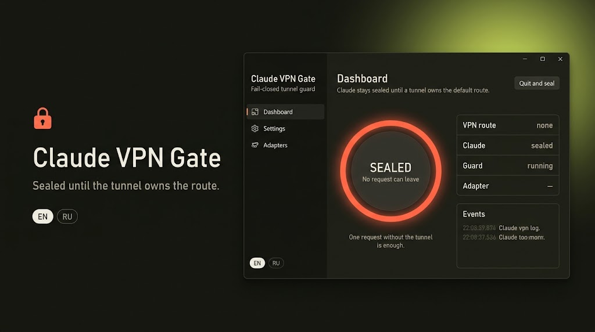

<p align="center">
  
</p>

# Claude VPN Gate

**English** · [Русский](README_RU.md)

Claude stays sealed until a VPN tunnel owns the default route. A VPN app that is merely open does not count. One request without that route is the failure this guard exists to stop.

The window uses the Windows Settings layout (side navigation, settings cards) and runs on Windows, Linux, and macOS. English is the default language. Russian is the alternate.

## Download

| System | Installer |
| --- | --- |
| Windows 10/11 x64 | `ClaudeVPNGate-Setup-1.0.0.exe` |
| Linux x64 | `ClaudeVPNGate-linux-x64.tar.gz` |
| macOS Apple Silicon | `ClaudeVPNGate-macos-arm64.tar.gz` |
| macOS Intel | `ClaudeVPNGate-macos-x64.tar.gz` |

Windows: run the setup. It asks for administrator rights, which the seal needs.

Linux: unpack and run `sudo sh install-linux.sh`, then `pkexec /opt/claude-vpn-gate/ClaudeVPNGate`.

macOS: unpack and run `bash install-macos.sh`.

## What “sealed” means

While the default route is not a tunnel, the guard sinkholes Claude and Anthropic host names, turns off browser secure DNS where the OS allows it, blocks the Claude program in the Windows firewall, stops Claude processes, and cuts existing IPv4 sessions to those names.

Closing the window only minimizes it. **Quit and seal** locks Claude again until this guard is running and the tunnel is back.

An adapter name the guard does not recognize stays sealed. Add a keyword under Settings.

## Build

```powershell
./build.ps1
```

Requires the .NET 10 SDK. The Windows installer also needs Inno Setup 6.
