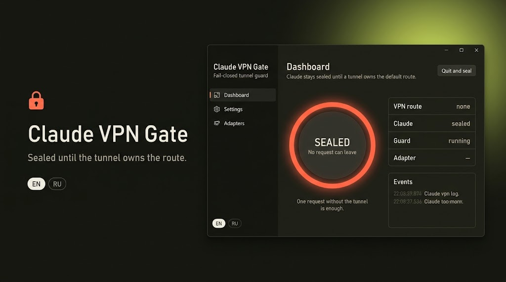

  

# Claude VPN Gate

[English](README.md) · **Русский**

Claude закрыт, пока VPN-туннель не держит маршрут по умолчанию. Открытое окно клиента VPN не считается. Один запрос без этого маршрута — то, от чего страж и закрывает дорогу.

Окно собрано как «Параметры» Windows: меню слева и карточки. Сборки есть для Windows, Linux и macOS. Язык по умолчанию — английский, русский переключается внизу меню.

## Скачать

| Система | Файл |
| --- | --- |
| Windows 10/11 x64 | `ClaudeVPNGate-Setup-1.0.0.exe` |
| Linux x64 | `ClaudeVPNGate-linux-x64.tar.gz` |
| macOS Apple Silicon | `ClaudeVPNGate-macos-arm64.tar.gz` |
| macOS Intel | `ClaudeVPNGate-macos-x64.tar.gz` |

Windows: запустите установщик. Права администратора нужны, чтобы печать реально ставилась.

Linux: распакуйте и выполните `sudo sh install-linux.sh`, затем `pkexec /opt/claude-vpn-gate/ClaudeVPNGate`.

macOS: распакуйте и выполните `bash install-macos.sh`.

## Что значит «закрыт»

Пока маршрут по умолчанию не туннель, программа уводит имена Claude и Anthropic на localhost, где возможно выключает безопасный DNS браузера, на Windows блокирует программу Claude в брандмауэре, останавливает процессы Claude и обрывает уже открытые IPv4-сессии к этим именам.

Крестик только сворачивает окно. **Выйти и закрыть** снова запирает Claude, пока страж не запущен и туннель не поднят.

Незнакомое имя адаптера остаётся закрытым. Добавьте слово в Параметрах.
